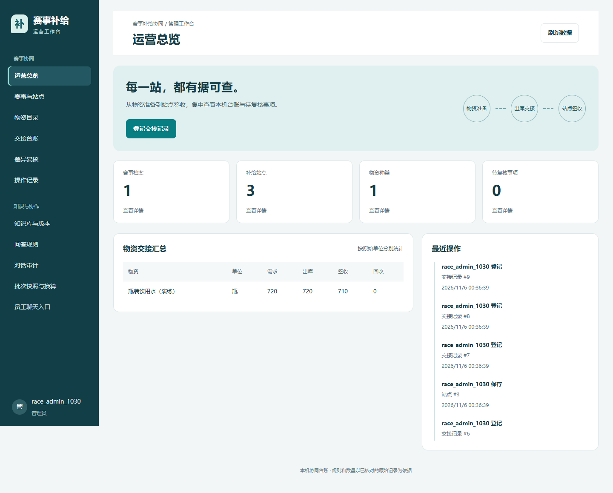

# 运营工作台与开源选型

## 本次交付

2026-11-06 补充六个运营页面。管理员从聊天页的“管理工作台”进入，地址为 `/admin/operations`。

| 页面 | 已实现的行为 |
| --- | --- |
| 运营总览 | 查询数据库中的赛事、站点、物资及待复核数量，按原始单位汇总交接数量，展示最近操作 |
| 赛事与站点 | 创建和编辑档案，启用或归档赛事，维护公里点、联系人及员工查询授权 |
| 物资目录 | 创建和编辑物资名称、分类、备注，固定编号和基准单位 |
| 交接台账 | 登记需求、出库、签收和余料回收，筛选、分页、作废、CSV 模板与导入导出 |
| 差异复核 | 查看员工提交的草稿，填写复核意见，标记完成或要求补充资料 |
| 操作记录 | 查询台账操作人与时间，展开查看变更前后内容 |

台账发布会调用既有 Agent 批次接口，员工继续从聊天入口核对已授权快照。回收记录单独保留。台账变化和站点授权变化均撤销相关旧快照，需要管理员重新核对发布。对归档赛事的修改须先重新启用。

## 开源检索与采用

| 来源 | 用途 | 本次采用方式 |
| --- | --- | --- |
| Anthropic frontend-design | 视觉方向、布局、字体层级和交互验收 | 已通过 skill-installer 安装到本机 Codex 技能目录，读取并应用设计规范 |
| FastAPI full-stack-fastapi-template | FastAPI 全栈工程参考 | 参考前后端分工与开发验证方式，保留项目已经运行的 FastAPI、SQLite 和原生前端 |
| Tabler | 管理后台布局和组件参考 | 研究其导航、表格和后台页面组织，界面 CSS 按本站业务编写 |
| Manikandeswaran-C inventory-management-system | FastAPI 与 SQLite 库存场景参考 | 参考目录与出入库管理场景，将本站实现限定为赛事交接台账 |

[frontend-design 源码](https://github.com/anthropics/skills/tree/main/skills/frontend-design) · [FastAPI 官方模板](https://github.com/fastapi/full-stack-fastapi-template) · [Tabler](https://github.com/tabler/tabler) · [库存项目](https://github.com/Manikandeswaran-C/inventory-management-system)

安装的 skill 位于开发工具的技能目录，后续对话可自动发现。本项目仓库中的业务代码、页面和样式由本次实现维护，第三方项目整仓文件未计入源码统计。MIT 许可继续按项目 LICENSE 执行。

## 视觉规范

核心颜色采用深蓝绿 `#173B45`、操作蓝绿 `#087E83`、浅灰白 `#F2F6F7`、白色 `#FFFFFF` 与待处理橙色 `#B86421`。中文界面优先使用系统雅黑、苹方字体，标题、字段和辅助信息保持明确的字号层级。

桌面采用固定宽度导航与可伸缩内容区，首页以真实数据汇总和近期操作为主。手机端导航折行为可点击入口，宽表格在容器内横向滚动。输入框保留可见标签，弹窗提供键盘焦点和关闭操作，页面使用系统减少动态效果偏好。

## 数据与一致性

- 赛事、站点、物资编辑带版本号，过期版本返回 409。
- 记录按站点、批次、交接编号唯一，内容一致的重复导入返回已有记录。
- CSV 全部行验证后在一个事务中导入，任一冲突使本批导入回滚。
- 数量使用 Decimal 汇总，不自动合并箱与份。
- 作废保留原始数量、理由和变更记录，汇总排除已作废记录。
- 所有运营接口限定管理员，导出保留操作审计并处理表格公式注入。
- 本机单 worker 串行处理运营写入和快照发布。多 worker 部署前应改为共享数据库锁或任务队列。

## 测试与演示

新增运营测试覆盖权限、版本冲突、归档限制、数量与日期校验、重复导入、CSV 整体回滚、单位隔离、快照撤销和管理员复核。

浏览器验证包含六个页面导航、弹窗打开关闭、桌面 1440 像素和手机 390 像素布局。演示库中的“城市半程马拉松 · 演练”、三个站点和交接记录属于本机合成样例，真实业务使用前需录入经核对的正式资料。

## 代码规模口径

运行以下命令可以重新统计。

```powershell
.venv/Scripts/python.exe scripts/code_metrics.py
.venv/Scripts/python.exe scripts/code_metrics.py --json
```

统计范围为 src、tests、scripts 和 examples 中的 Python、JavaScript、CSS、HTML 与脚本。物理行包含空行和注释，非空行包含注释。Python 另提供排除注释和文档字符串的 token 行数。依赖、模型、缓存、构建产物、文档、演练数据和第三方技能不计入。

本次包含对旧有密集单行代码的标准化排版，因此增加的行数由新增功能和排版共同构成。功能完成度以页面、接口、权限及测试结果验收。



[手机页面截图](images/运营工作台_手机.png)
